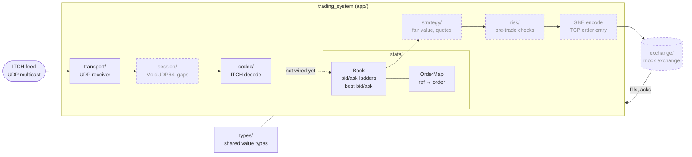

# marketmaking

A low-latency market-making system in C++23, built alongside a mock exchange to trade against.
It reads Nasdaq ITCH market data over UDP, keeps a per-symbol order book, and will quote back out
over SBE/TCP.

## Architecture

```
types/      shared value types (Side, ...); depends on nothing, so every layer can include it.
transport/  UDP socket that receives raw datagrams; knows nothing about what the bytes mean.
session/    MoldUDP64 sequence numbers and gap detection, so dropped packets are noticed. (not started)
codec/      ITCH decoding: bytes -> typed messages, bounds-checked, no I/O.
state/      the order book: an order-ref hash map plus tick-indexed bid/ask ladders and best bid/ask.
strategy/   fair value and quoting logic that decides what to bid and offer. (not started)
risk/       pre-trade checks that every outgoing order must pass. (not started)
app/        main and the event loop: wires transport -> codec -> book together.
exchange/   the mock exchange, a separate binary that shares codec/ but not the book. (not started)
tools/      replay, book dumper and latency histograms. (not started)
test/       one test binary per layer, mirroring the source tree.
z_notes/    topic-organized learning notes and changelog; z_questions/ holds open questions.
```

## Build, test, run

From the project root:

```sh
# configure once (re-run only after deleting build/)
cmake -S . -B build -G Ninja -DCMAKE_BUILD_TYPE=Debug

# compile the trading system
cmake --build build

# tests are built by name, then run
cmake --build build --target test_codec test_order_map test_book
ctest --test-dir build --output-on-failure

# start the system: listens for ITCH datagrams on UDP port 8080 (Ctrl-C to stop)
./build/trading_system
```

For latency measurements use a Release build in its own directory
(`cmake -S . -B build-release -G Ninja -DCMAKE_BUILD_TYPE=Release`), never Debug.
Debug enables ASan/UBSan by default; if ASan hangs on your machine, configure with
`-DMM_SANITIZE=OFF`.

Working agreement and priorities: [AGENTS.md](AGENTS.md).

## Diagram

Solid = built, dashed = planned.


